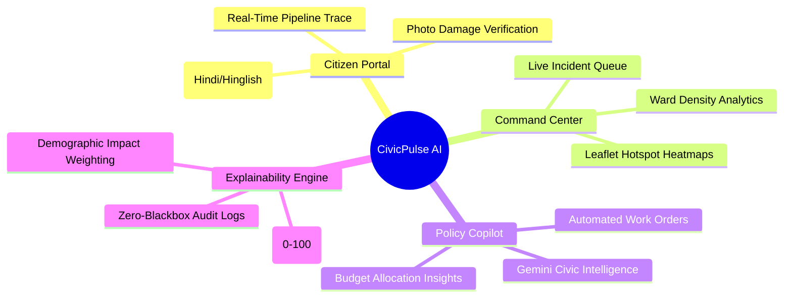
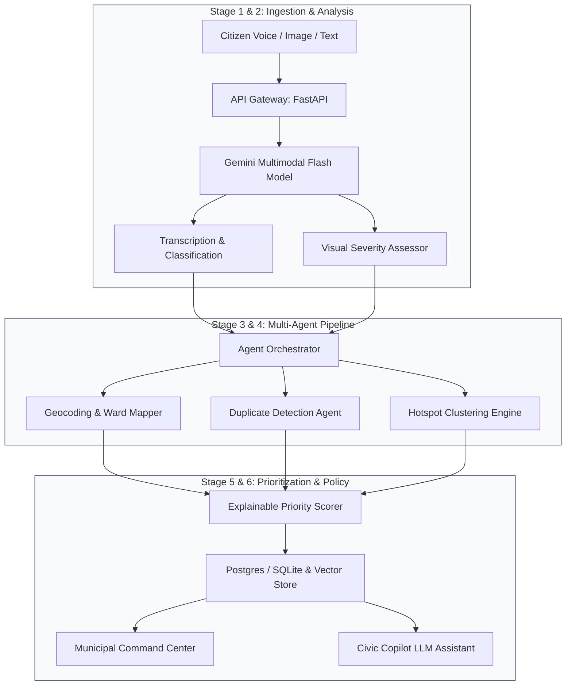

<div align="center">

# 🏛️ CivicPulse AI
### *Civic Demand Intelligence & Explainable Infrastructure Prioritization*

[](https://frontend-hazel-ten-7k2jqk6k5r.vercel.app)
[](https://frontend-hazel-ten-7k2jqk6k5r.vercel.app)
[](LICENSE)

<br/>

**Transforming chaotic, multilingual citizen feedback into explainable municipal development priorities.**

[ Explore Live Web App ](https://frontend-hazel-ten-7k2jqk6k5r.vercel.app) · [ Report Issue ](https://github.com/) · [ Architecture Spec ](context/ARCHITECTURE.md)

<br/>

```
      Citizen Voice/Image ──► Multimodal Gemini AI ──► 6-Stage Agent Pipeline
                                                               │
     Actionable Work Orders ◄── Municipal Copilot ◄── Hotspot & Priority Engine
```

---

### 🌐 Quick Navigation

[✨ Features](#-key-features) • 
[🚀 Live Demo](#-live-deployment) • 
[🏗️ Architecture](#️-multi-agent-system-architecture) • 
[📊 Priority Formula](#-explainable-priority-scoring) • 
[⚡ Quickstart](#-quickstart-guide) • 
[🔌 API Docs](#-api-endpoints) • 
[👥 Team](#-team--hackathon)

---

</div>

<br/>

## 🌐 Live Deployment

> **Experience CivicPulse AI in production:**  
> 👉 **[https://frontend-hazel-ten-7k2jqk6k5r.vercel.app](https://frontend-hazel-ten-7k2jqk6k5r.vercel.app)**

| Component | Status | URL |
| :--- | :--- | :--- |
| **Frontend Portal** |  | [frontend-hazel-ten-7k2jqk6k5r.vercel.app](https://frontend-hazel-ten-7k2jqk6k5r.vercel.app) |
| **API Backend** |  | `Local / Cloud Run Port 8000` |
| **Interactive Docs** |  | `/docs` |

<br/>

---

## 💡 The Problem & CivicPulse Solution

<div align="center">

| 🛑 The Traditional Civic Dilemma | 💡 The CivicPulse AI Breakthrough |
| :--- | :--- |
| **Fragmented Reporting**: Citizens complain on WhatsApp, calls, walk-ins, and Twitter with zero cross-correlation. | **Unified Multimodal Ingestion**: Collects Hindi/Hinglish voice notes, geo-tagged photos, and text into one pipeline. |
| **Unstructured Ingestion**: Municipal desks get raw audio and blurry photos lacking verifiable metrics. | **Gemini Multimodal Processing**: Auto-transcribes, identifies landmarks, rates severity (1–5), and validates damage photos. |
| **Squeaky Wheel Syndrome**: Authorities react to the loudest callers instead of chronic structural failure zones. | **DBSCAN Demand Hotspot Engine**: Leaflet.js interactive maps cluster issues by geographic density and recurrence. |
| **Opaque Budgeting**: Funds are allocated via intuition or political pressure without transparent audit trails. | **Explainable Priority Score (0–100)**: Mathematical ranking based on volume, severity, duration, and equity weighting. |

</div>

<br/>

---

## ✨ Key Features



<details open>
<summary><b>1. 🎙️ Multilingual Voice & Multimodal Ingestion</b></summary>
<br>

- **Colloquial Hindi / Hinglish Transcription**: Citizens speak naturally (*"Palasia square pe do din se bada gaddha hai..."*).
- **Gemini Multimodal Analysis**: Transcribes audio, extracts primary and secondary infrastructure categories, infers severity on a scale of 1 to 5, and pinpoints geographic landmarks.
- **Image Evidence Validation**: Verifies that uploaded photographs correspond to reported civic defects.
</details>

<details>
<summary><b>2. 🗺️ Geospatial Hotspot & Density Engine</b></summary>
<br>

- **Interactive Ward Map**: Powered by Leaflet.js and centered on Indore's municipal zones (Palasia, Vijay Nagar, Rajwada, Bhanwar Kuan, etc.).
- **Dual Visual Modes**: Toggle between raw complaint markers and density heatmaps.
- **Micro-Cluster Analysis**: Groups geographically adjacent complaints to reveal systemic infrastructure decay before catastrophic failures.
</details>

<details>
<summary><b>3. 🧠 69-Agent Deterministic Pipeline with Live Trace</b></summary>
<br>

- **Zero-Collision Pipeline Contract**: 6 distinct processing stages running specialized deterministic agents with ~6 selective Gemini LLM touchpoints.
- **300ms Live Trace Polling**: Citizen UI visualizes every agent step in real-time, delivering complete civic transparency.
</details>

<details>
<summary><b>4. 🤖 AI Policymaker Copilot</b></summary>
<br>

- **Context-Aware Querying**: Ask questions like *"Which ward requires immediate road repair budget this week?"*
- **Actionable Syntheses**: Produces executive briefings, suggests contractor work orders, and estimates budget requirements with zero hallucinations.
</details>

<br/>

---

## 🏗️ Multi-Agent System Architecture



<br/>

---

## 📊 Explainable Priority Scoring

CivicPulse AI rejects black-box algorithms. Every issue receives a transparent score between **0 and 100**:

$$\text{Priority Score} = \min\left(100, \max\left(0, S_{\text{sev}} + S_{\text{freq}} + S_{\text{pop}} + S_{\text{age}} + S_{\text{conc}} - D_{\text{trust}}\right)\right)$$

| Component | Weight | Calculation Basis |
| :--- | :---: | :--- |
| **Severity ($S_{\text{sev}}$)** | `25%` | Assessed physical hazard level (1–5) normalized to 25 |
| **Frequency ($S_{\text{freq}}$)** | `20%` | Number of distinct reports received for the same issue |
| **Population Impact ($S_{\text{pop}}$)** | `15%` | Ward population footfall & proximity to critical amenities |
| **Recency / Age ($S_{\text{age}}$)** | `15%` | Unresolved days elapsed since first incident filing |
| **Spatial Density ($S_{\text{conc}}$)** | `15%` | Proximity to active geographic cluster / hotspot |
| **Trust Factor ($D_{\text{trust}}$)** | `±5%` | Deductions for unverified claims or anti-spam filtering |

<br/>

---

## 🛠️ Tech Stack & Integrations

<div align="center">

| Layer | Technologies |
| :--- | :--- |
| **Frontend** | React 18 · TypeScript · Vite · Tailwind CSS · Leaflet.js · Recharts · GSAP · Lenis Smooth Scroll |
| **Backend** | Python 3.10+ · FastAPI · Pydantic v2 · SQLAlchemy · SQLite / PostgreSQL · AsyncIO |
| **AI & Multimodal** | Google Gemini 1.5 / 2.0 Flash (Audio, Vision & Reasoning) · Structured JSON Schemas |
| **Authentication & Ops** | Firebase Auth · Docker · Vercel Edge Network |

</div>

<br/>

---

## ⚡ Quickstart Guide

### 📋 Prerequisites
- **Node.js**: v18 or higher
- **Python**: v3.10 or higher
- **Google Gemini API Key**: Obtain via [Google AI Studio](https://aistudio.google.com/)

---

### 1️⃣ Clone the Repository

```bash
git clone https://github.com/your-username/CivicPulse-AI.git
cd CivicPulse-AI
```

### 2️⃣ Backend Setup

```bash
cd backend

# Create and activate virtual environment
python -m venv venv
# Windows:
venv\Scripts\activate
# Linux/macOS:
# source venv/bin/activate

# Install dependencies
pip install -r requirements.txt

# Configure Environment Variables
cp .env.example .env
# Open .env and insert your GEMINI_API_KEY

# Run server
python -m uvicorn main:app --reload --port 8000
```
*API running at `http://localhost:8000` • Docs at `http://localhost:8000/docs`*

### 3️⃣ Frontend Setup

```bash
cd ../frontend

# Install packages
npm install

# Start development server
npm run dev
```
*App running at `http://localhost:5173`*

---

### 4️⃣ One-Click Local Runner

<details>
<summary><b>PowerShell (Windows)</b></summary>

```powershell
./run-local.ps1
```
</details>

<details>
<summary><b>Bash (Linux / macOS)</b></summary>

```bash
chmod +x run-local.sh
./run-local.sh
```
</details>

<br/>

---

## 🔌 API Endpoints

<details>
<summary><b>Click to expand Endpoint Table</b></summary>
<br>

| Method | Endpoint | Description |
| :--- | :--- | :--- |
| `POST` | `/api/v1/complaints/submit` | Multimodal complaint submission (Voice, Photo, Text) |
| `GET` | `/api/v1/pipeline/{id}` | Real-time stage execution trace (polled every 300ms) |
| `GET` | `/api/v1/hotspots` | DBSCAN clustered demand hotspots with bounding boxes |
| `GET` | `/api/v1/wards` | Ward list with priority metrics and demographic stats |
| `POST` | `/api/v1/copilot/query` | Gemini-powered policy intelligence query |
| `POST` | `/api/v1/admin/actions` | Create work orders, assign budgets, or close issues |

</details>

<br/>

---

## 🎯 Demo Walkthrough for Judges

- [x] **Step 1: Multimodal Ingestion** — Submit voice in Hindi via citizen portal; observe Gemini instant classification and photo defect verification.
- [x] **Step 2: Real-Time Pipeline Trace** — Watch the 6-stage agent cascade execute live in under 2 seconds.
- [x] **Step 3: Geospatial Command Center** — Open the interactive Leaflet map to inspect hotspots in Palasia & Vijay Nagar.
- [x] **Step 4: Audit Priority Score** — Click any incident to inspect the mathematical breakdown and verify zero black-box scoring.
- [x] **Step 5: Policymaker Copilot** — Ask the Copilot for emergency road repair allocation and generate automated action orders.

<br/>

---

## 👥 Team & Hackathon

Developed with ❤️ for the **Google Developer Group (GDG) Indore Hackathon**.

<div align="center">

[](https://frontend-hazel-ten-7k2jqk6k5r.vercel.app)
[](https://frontend-hazel-ten-7k2jqk6k5r.vercel.app)

<sub>Built to empower citizens and transform governance through explainable artificial intelligence.</sub>

</div>
